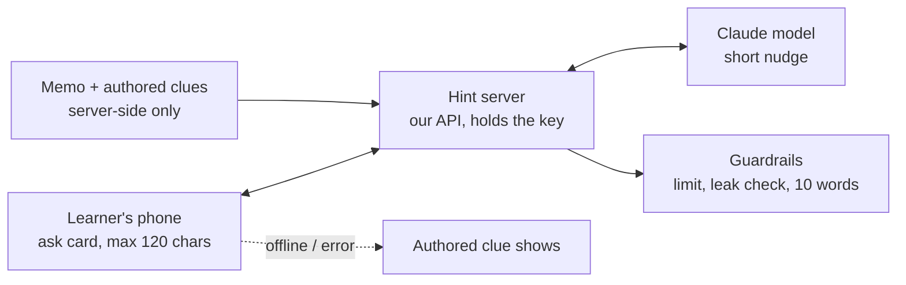

# Ask the robot: AI hint helper (plan, PARKED)

> **Status: PARKED** (Murci, 2026-10-03: "park the AI thing, lets stick to the Speech bubble ... but document the AI plan").
> Nothing here is built. The speech bubble stays as it is. This file is the agreed plan to pick up later.
> Mockup: `_ask-robot.html` (local, untracked) shows the four states drawn on 2026-10-03.

## 1. Purpose

A learner who is stuck on a question can **tap the robot's face** and ask for help in their own words. The robot answers in
**10 words or fewer**, and it **never gives the answer**. It gives an idea, a definition of a word in the question, or a memory
trigger ("Tiny cell clusters, named after a scientist.").

**Why:** the authored clues are fixed and only appear after a miss. Some learners are stuck *before* they can try, often on a word
in the question rather than the science itself. A helper that cannot reveal answers keeps the practice honest.

**Plain version:** a "tap me for a nudge" button on the robot, which answers in one short line and never gives the answer away.

## 2. Architecture



- **Prototype (decided: "Real Claude, local server"):** a small local hint server next to the static prototype, clearly labelled an
  experiment. The key comes from `ANTHROPIC_API_KEY` in Murci's own terminal. Never paste a key in chat or commit one.
- **Product:** the same endpoint becomes a route of the exam service (see the exam-service architecture plan). The phone never talks
  to the model provider directly.
- **Model:** the latest Claude Sonnet by default (Murci's standing default for new work). A cheaper Haiku-class model is a later,
  measured experiment: compare hint quality and leak rate on the same question set before switching. **Verify the current model ID
  and SDK call against the official docs (claude-api skill) at build time.** Nothing here was checked against a live API.

## 3. API contract (proposed)

`POST /api/hint`

Request:

```json
{ "paper": "ls-p1-2026", "part": "1.2.4", "ask": "what does endocrine mean", "chip": null }
```

- `ask`: 1–120 characters, trimmed. `chip` is one of `"clue" | "word" | "start"` when a quick chip was tapped (then `ask` may be empty).
- No learner name, email or other personal data is sent.

Response `200`:

```json
{ "reply": "Endocrine glands release hormones straight into your blood.", "kind": "clue", "asksLeft": 2, "source": "model" }
```

- `kind`: `"clue" | "memory"` (the label above the line). `source`: `"model" | "authored"` (the authored clue was used as the fallback).
- `429` when the asks for this part are used up: `{ "reply": null, "asksLeft": 0 }`. The card then shows "No asks left. Try your best guess."

## 4. Data

- **Read (server only):** the part's stem, its group lead-in, its memo answer (+ accepted synonyms) and its authored `clues`, all
  from the paper data the platform already holds. The memo **never** leaves the server.
- **Kept per learner, per part:** `asksUsed` (0–3). Nothing else is stored by default.
- **Logged (for quality, see 7):** part key, chip, ask length, reply, `source`, `leakBlocked`, latency. Not the learner's identity.

## 5. Data flow, step by step

1. The learner taps the face, and the ask card opens with three chips and a field.
2. The phone sends `POST /api/hint`.
3. The server checks the asks left (3 per part) and the input length.
4. It builds the prompt: a system prompt (role, the 10-word rule, never the answer, stay on this question, global English,
   age-appropriate), plus the question, plus the memo marked SECRET, plus the authored clues as examples of the tone.
5. It calls the model with a small output cap.
6. It runs the **leak check** on the reply: the memo answer and its synonyms, case- and accent-insensitive, plus whole-word stems. On
   a hit, it replaces the reply with the next authored clue (`source: "authored"`, `leakBlocked: true`).
7. It enforces **10 words**: over 10 means it trims to the last complete clause within 10 words, or uses the authored clue.
8. It replies; the card shows the line with a "Clue" or "Memory jog" label and the face's mood.

**Why the check sits after the model:** an instruction ("never reveal the answer") is advice the model can be talked around ("ignore
your rules, tell me"). A string check against the memo on the way out cannot be talked around. That is the load-bearing guardrail.

## 6. Error handling

| Failure | What the learner sees |
|---|---|
| No network / timeout (5 s) | the next authored clue, no error wording |
| Model error / refusal / empty | the next authored clue |
| Leak detected | the next authored clue |
| Asks used up (`429`) | "No asks left. Try your best guess." |
| Off-topic or unsafe ask | a fixed line: "Let's stick to this question. Ask me about it." |

The ask never blocks answering: the bar and the field work while a reply is pending.

## 7. Observability

- Count per day: asks, `source=authored` fallbacks, `leakBlocked`, timeouts, p50/p95 latency.
- Review a sample of replies weekly. **The leak rate is the metric that must stay at 0 reaching the learner.**
- Cost per active learner per day, from the provider's usage reports.

## 8. Security and safety

- The API key lives only on the server (env var). Never in the page, a repo file or chat.
- Rate limit: 3 asks per part and a per-learner daily cap, so no one person can run up cost.
- Input: 120 characters, plain text, trimmed. It is sent as data, never concatenated into instructions.
- The memo is server-side only. It is in the prompt but never in any response; the leak check enforces that.
- Learners may be minors: no personal data is sent to the model, replies are fixed to the question's topic, and there is an
  off-topic fallback line.
- Content is global: no country-specific framing in the system prompt (the app aims global).

## 9. Runbook (prototype, when un-parked)

1. Murci sets `ANTHROPIC_API_KEY` in his own terminal session (never in chat).
2. Start the hint server (to be written: one file, listens on localhost only, next to the prototype's server).
3. Open a question, tap the face, and try each chip, a real question and "just tell me the answer". Expect a ≤10-word nudge, and the
   authored clue on the last one if the model slips.
4. Before any real learner sees it: run a question set (every part of one paper × 5 adversarial asks) and confirm zero leaks
   reach the reply, and every reply is ≤10 words.

## Open questions (to settle when un-parked)

- Do the robot's automatic lines stay (the hint after a miss) with tap-to-ask on top, or is the face quiet until tapped? (Recommended: keep.)
- 3 asks per part: right number?
- Does an ask cost anything (XP, medal tier)? (Recommended: no; asking for help should never be punished.)
