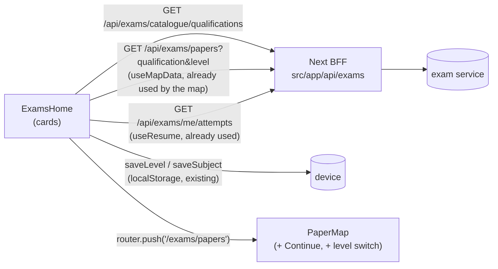

# Port plan: the Home chooser (direction A) to the platform

**Status:** plan, 2026-10-25. Nothing in the platform has changed yet.
**Source of truth:** the prototype, `Exam Practice.dc.html` at `d82bdba` (Home chooser) on top of `5b53fae` (render
crash fix). The three directions that were compared live in `exam-design-mocks/map-chooser/` (Murci picked A).
**Target:** `Nudle-Pty-Ltd/nexerastudioui-jilan-veron`, on top of PR #7 (`feat/exams-re-walkin`), which is where RE
and the newest map live. Jilan reviews, as for every port (rulings 2026-10-10).

## 1. What changes for a learner

| Page | Today (platform) | After the port |
| --- | --- | --- |
| Home `/exams` | Robot hero, "Beat the paper.", one line "Grade 12 past papers ⌄" (opens the level sheet), Start; a returning learner sees "Welcome back." and a Continue card | "Beat the paper." / "Welcome back.", field chips (only when more than one field is shown), then **Your subjects**: Surprise me + one tall card per subject. Tap = open the card, second tap = its road |
| Map `/exams/papers` | Title, subject chips, road | **Continue card** (when a paper is under way) and the **level switch** first, then the chips and the road, unchanged |

The road, the cup, the paper sheet, the RE map and every 2026-10-02 map ruling stay as they are.

## 2. Data flow (no new service work)

Every call already exists. The cards read the same paper list the map reads (`useMapData(qualification, level)`), so
the counts, sittings, marks and times on a card always match the road. Progress on a card = the map's own
`roadPaper` state (done / going / new), so the card and the road never disagree.

## 3. Work, in slices (each one a commit, each one green on its own)

1. **`levels.ts`: the field list.** One function `homeFields(quals)` built on `shownQualifications` + `PARENT`:
   "High school" (nsc) and "Vocational training" (ncv, with Insurance inside it). Unit tests beside `levels.test`.
2. **`home/SubjectDeck.tsx` (new):** Surprise me + the subject cards. Props: the level, `useMapData`'s data, and the
   open card. Subject colour/icon from `mapModel.subjectLook` (the map's own). For RE (`oneMap`) the cards are the two
   exams with `careers.ts` copy ("Your licence to advise clients"), the office-robot art (`avatars/re/still.webp`).
   Surprise me: a random unfinished paper, `saveSubject` + `router.push("/exams/papers?open=<paper id>")`.
3. **`home/ExamsHome.tsx`:** drop the robot stage, the level line and Start; render the field chips + `SubjectDeck`.
   The Continue card leaves Home. **Delete** the dead poster/stage code here, not hide it (the prototype only hides it).
4. **`map/PaperMap.tsx`:** a lead block above the chips: the Continue card (from `useResume`, moved from Home) and the
   level switch (`saveLevel`, then refetch). Read `?open=<paper id>` once to open that paper's sheet (Surprise me).
5. **Styles:** port `.hm-*` and `.pm-lead` from the prototype's `nx-map.css` into `styles/map.css` + `light.css`
   (the light theme needs its own card ground: never pure white, ruling 2026-10-11).
6. **Docs:** the module `README.md` (Home + map sections, the ruling, why the Continue card moved) and `CLAUDE.md`.

## 4. How it is checked (definition of done)

- `npx vitest run --no-file-parallelism`, `npx tsc --noEmit`, the exams eslint: green. Run them one at a time
  (3.4 GB laptop).
- New tests: `homeFields` (fields shown / hidden), SubjectDeck (first tap opens, second navigates, Surprise me never
  picks a finished paper, all-done shows the note), PaperMap (`?open=` opens the sheet once; the lead shows the
  Continue card only with a paper under way).
- In a browser against the real service (`exam-latest` on :8092): every screen at **360×702 (P30 lite)**,
  **768×1024** and **desktop**, both themes, a first visit and a returning learner, School and Insurance. Then the
  real P30 over USB.
- Accessibility (the prototype cannot show it): cards are buttons with `aria-expanded`; the level switch is a
  `role="group"` of `aria-pressed` buttons; focus moves to the opened card; reduced motion turns the width animation
  off; tap targets ≥ 44 px.
- Performance: the 7 card images are one shared file (`home-robot.webp`, 82 KB, cached once) plus the RE avatar
  (26 KB); `loading="lazy"`. No 3D on Home.

## 5. Decisions needed before slice 3 (Murci)

1. **Fields on the platform.** The platform shows High school (Grade 12) AND Vocational training (NC(V) L2-4 with
   Insurance inside). So the chips WILL show there. Proposed: two chips, "High school" and "Vocational training";
   inside Vocational, the level switch reads `L2 · L3 · L4 · Insurance`, and Insurance's cards are RE5 and RE1.
2. **Robot on every card vs a robot per field.** Today one casual robot for school, the office robot for Insurance
   (the existing pattern). A per-subject outfit is a later art task, not a blocker.
3. **Where the Continue card's paper lives when its level is not the one shown.** Proposed: the card always shows
   the paper under way, whatever level the map shows (it is the learner's next step, not the level's).

## 6. Risks

| Risk | Mitigation |
| --- | --- |
| Home now needs the paper list before it can draw cards (one more request on first paint) | The same request the map makes next; cache it in the hook so the map reuses it; skeleton cards meanwhile |
| A learner used to "Start" on Home | The first card is the subject they used last (`loadSubject`), already scrolled into view |
| Prototype and platform drift | The port copies class names and values from `nx-map.css`; the README records the prototype commit |
| One crash blanks every screen (the prototype bug fixed in `5b53fae`) | The platform splits screens into components; still add an error boundary around SubjectDeck |
